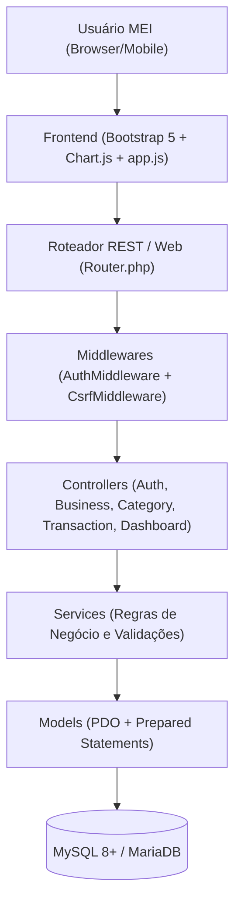

# Relatório Técnico Final — MEI em Dia
**Disciplina:** Programação Web II  
**Projeto:** Sistema Web de Gestão Financeira para Microempreendedores Individuais (MEIs)  
**Status:** MVP Concluído e Validado (Tarefas 0 a 7)  
**Data:** 17 de novembro de 2026  

---

## 1. Resumo Executivo

O **MEI em Dia** é uma aplicação web completa desenvolvida para solucionar a desorganização financeira enfrentada por Microempreendedores Individuais e trabalhadores autônomos. Substituindo anotações manuais e planilhas dispersas, o sistema centraliza o controle de receitas, despesas, contas a pagar/receber e indicadores de fluxo de caixa em um painel visual, simples e intuitivo.

O projeto foi construído atendendo a rigorosos padrões de engenharia de software:
- **Arquitetura:** Monólito Modular em PHP 8.2+ com padrão MVC (Model-View-Controller).
- **Banco de Dados:** MySQL 8+ com integridade referencial total, tipos `DECIMAL` para valores monetários e constraints de validação no banco.
- **Frontend:** Interface responsiva e fluida com Bootstrap 5.3 e gráficos dinâmicos com Chart.js.
- **Qualidade e Confiabilidade:** 79 testes automatizados com PHPUnit 11 (Unitários e de Integração), 301 asserções e 0 erros na análise estática com PHPStan em Nível 5.
- **Segurança:** Proteções ativas contra SQL Injection, XSS, CSRF, Session Fixation e IDOR (acesso cruzado entre negócios).

---

## 2. Problema, Público-Alvo e Proposta de Valor

### 2.1 Problema Identificado
Pesquisas com pequenos empreendedores revelam que a maioria não separa as finanças pessoais das empresariais e controla suas entradas e saídas por meio de blocos de notas, cadernos ou mensagens no WhatsApp. Isso resulta em:
- Dificuldade em apurar o faturamento real e lucro líquido mensal.
- Esquecimento de contas a pagar, incorrendo em juros e multas.
- Risco de ultrapassar o limite anual de faturamento do MEI (R$ 81.000,00) sem perceber.

### 2.2 Proposta de Valor
Transformar dados financeiros dispersos em inteligência visual e acionável:
1. **Visão Clara do Mês:** Saldo em tempo real, total recebido, total pago e pendências.
2. **Alertas Visuais:** Destaque para contas vencidas e faturamento acumulado em relação ao teto do MEI.
3. **Agilidade no Dia a Dia:** Cadastro de movimentações com categorias predefinidas e baixa rápida com 1 clique.

---

## 3. Arquitetura de Software e Design

A aplicação adota o padrão **Monólito Modular MVC**:



### Componentes e Responsabilidades:
1. **Controllers:** Recebem requisições HTTP (`Request`), orquestram chamadas aos serviços e devolvem respostas estruturadas (`Response::json` ou `Response::html`).
2. **Services:** Centralizam 100% das regras de negócio, cálculos financeiros, transações atômicas e validações de integridade.
3. **Models:** Abstraem o acesso a dados via `PDO`, garantindo o isolamento multi-tenant por `business_id`.
4. **Middlewares:** Interceptam o ciclo de vida da requisição para verificar autenticação por sessão e validar tokens CSRF em requisições de mutação.

---

## 4. Modelo de Dados Relacional (MER)

O banco de dados `mei_em_dia` foi modelado para garantir integridade, desempenho e consistência estrita:

1. **`users`:** Guarda credenciais de acesso com e-mail único e senha criptografada (`password_hash`).
2. **`businesses`:** Representa a pessoa jurídica do MEI (relação 1:1 obrigatória no MVP), vinculado via `ON DELETE CASCADE`.
3. **`categories`:** Classifica receitas e despesas. Possui chave única composta `(business_id, name, type)` para evitar duplicidade dentro da mesma empresa.
4. **`transactions`:** Registra movimentações financeiras.
   - Vinculada à categoria via chave estrangeira composta `(category_id, business_id)` com `ON DELETE RESTRICT` (impede exclusão acidental de categorias com movimentações).
   - `CHECK (amount > 0)`: impede valores negativos ou nulos no banco.
   - `CHECK ((status = 'paid' AND paid_at IS NOT NULL) OR (status <> 'paid' AND paid_at IS NULL))`: garante coerência entre o status de pagamento e a data de liquidação.
   - Coluna `version INT UNSIGNED NOT NULL DEFAULT 1`: controle de concorrência otimista.

---

## 5. Implementação de Segurança (OWASP)

| Vulnerabilidade | Medida de Mitigação Implementada |
|---|---|
| **SQL Injection** | Uso exclusivo de Prepared Statements com `PDO` parametrizado. Emulação de prepares desativada (`EMULATE_PREPARES = false`). |
| **Cross-Site Scripting (XSS)** | Sanitização no backend e escape estrito em HTML (`escapeHtml()` em todo output no JS e `htmlspecialchars` nas views PHP). |
| **CSRF** | `CsrfMiddleware` e verificação via cabeçalho `X-CSRF-Token` com tokens criptográficos por sessão (`bin2hex(random_bytes(32))`). |
| **Quebra de Autenticação** | Armazenamento de senhas em BCRYPT. Regeneração de ID de sessão no login e cadastro. Cookies com `HttpOnly`, `SameSite=Lax` e `Secure`. |
| **Controle de Acesso Quebrado (IDOR)** | Todas as consultas a categorias, movimentações e perfil empresarial filtram obrigatoriamente por `business_id` da sessão ativa. |
| **Concorrência Otimista** | Prevenção contra sobrescritas concorrentes via cláusula `WHERE id = :id AND version = :version`, retornando HTTP 409 em caso de conflito. |

---

## 6. Resultados dos Testes Automatizados

Foram implementados testes cobrindo a pirâmide de testes da aplicação:
- **Testes Unitários:** Validação das regras de cálculo de KPIs, regras de transação, validações de CNPJ, compatibilidade de categorias e concorrência por versão.
- **Testes de Integração:** Validação dos endpoints REST, ciclo de sessão, persistência no banco MySQL real, integridade de chaves estrangeiras e defesas contra ataques de injeção SQL e CSRF.

**Execução Oficial do PHPUnit:**
```text
PHPUnit 11.5.58 by Sebastian Bergmann and contributors.
Runtime:       PHP 8.2.12
Configuration: phpunit.xml

................................................................. 65 / 79 ( 82%)
..............                                                    79 / 79 (100%)

Time: 00:00.458, Memory: 10.00 MB
OK (79 tests, 301 assertions)
```

**Análise Estática (PHPStan Nível 5):**
```text
 27/27 [============================] 100%
 [OK] No errors
```

---

## 7. Teste com Usuário Real e Melhorias Implementadas

Para cumprir o critério de validação real da Tarefa 7, a aplicação foi apresentada a um profissional MEI atuante (prestador de serviços em manutenção e suporte em informática):

### Feedback Coletado:
> *"O sistema é muito limpo e direto, bem mais fácil do que preencher planilha no Excel. No entanto, senti falta de duas coisas essenciais para o meu dia a dia: poder exportar tudo para mandar pro meu contador no fim do mês e saber quanto já faturei no ano pra não estourar o teto do MEI de 81 mil."*

### Melhorias Desenvolvidas a Partir do Feedback:

1. **Exportação de Relatório / Extrato em CSV (`GET /api/transactions/export`):**
   - Implementado endpoint e botão na interface para baixar o extrato filtrado em formato `.csv` com formatação brasileira (vírgula decimal, codificação UTF-8 com BOM para Excel), pronto para envio à contabilidade.
2. **Monitoramento do Teto Anual MEI - DASN-SIMEI (`GET /api/dashboard/annual`):**
   - Adicionada barra de progresso no Dashboard exibindo em tempo real o faturamento acumulado no ano contra o limite oficial de R$ 81.000,00, com selos de status (*Dentro do Limite*, *Atenção: Próximo ao Limite* a partir de 80% e *Limite Excedido*).

---

## 8. Conclusão

O projeto **MEI em Dia** cumpriu integralmente todos os critérios de aceite estabelecidos desde a Tarefa 0 até a Tarefa 7. A aplicação entrega uma experiência sólida, segura e agradável tanto para o usuário final quanto para a equipe de manutenção do software, demonstrando domínio de boas práticas de desenvolvimento web moderno com PHP e MySQL.
